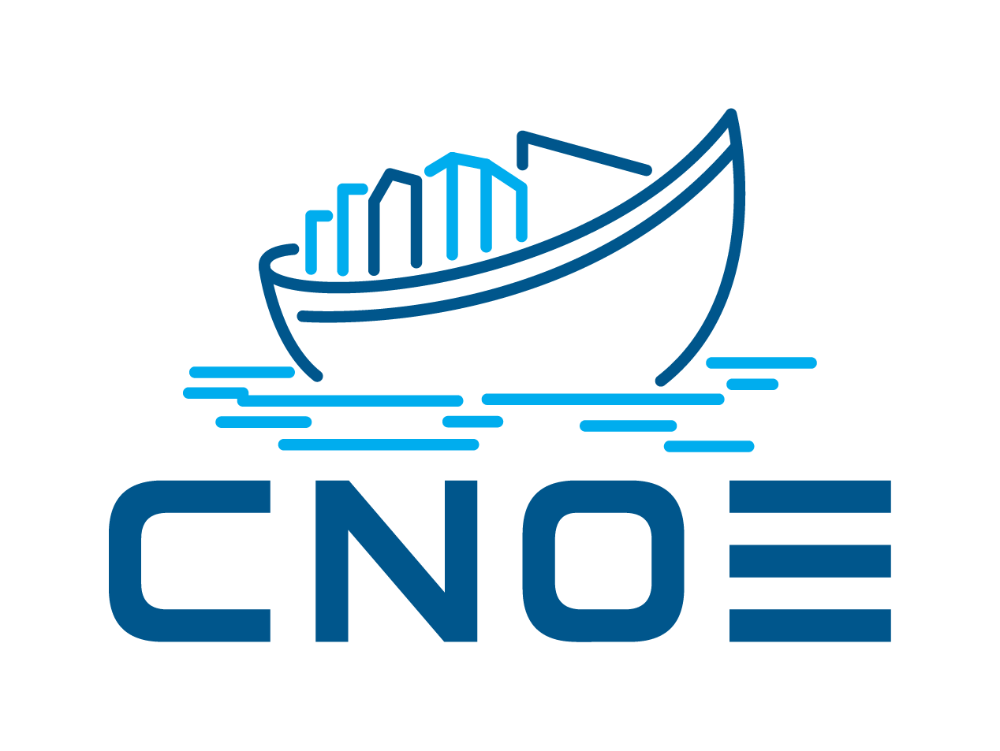

# Example Basic Application

Thanks for trying out this demo! In this example, we deploy a simple application with Crossplane-managed object storage metadata.

The template creates a namespaced `ObjectStorage` resource using `platform.pittampalli.io/v1alpha1`.

### idpbuilder

Checkout the idpbuilder website: https://cnoe.io/docs/reference-implementation/installations/idpbuilder

Checkout the idpbuilder repository: https://github.com/cnoe-io/idpbuilder

## Crossplane

Checkout the Crossplane website: https://www.crossplane.io/
